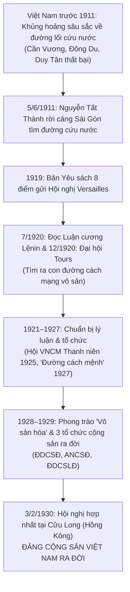

# 🚩 HÀNH TRÌNH ĐỎ (1911 – 1930): CON ĐƯỜNG ĐẾN VỚI ĐẢNG
### TÀI LIỆU GIỚI THIỆU TỔNG QUAN, BỐI CẢNH LỊCH SỬ, HƯỚNG DẪN TRẢI NGHIỆM & BÀI HỌC THỰC TIỄN

> **"Không phải học thuộc lòng lịch sử, mà là cùng sống và cùng đưa ra lựa chọn với lịch sử."**  
> 🌐 **Trải nghiệm trực tiếp trên trình duyệt (Web & Mobile):** [https://hanh-trinh-do.vercel.app](https://hanh-trinh-do.vercel.app)  
> ⏱️ **Thời lượng trải nghiệm:** Khoảng 20 – 25 phút (bao gồm cốt truyện tương tác, 7 ngã rẽ tư tưởng, khám phá tư liệu và câu hỏi củng cố).  
> 📚 **Căn cứ học thuật chính thống:** *Giáo trình Lịch sử Đảng Cộng sản Việt Nam (Dành cho bậc đại học hệ không chuyên lý luận chính trị)*, Nxb. Chính trị quốc gia Sự thật, Hà Nội, 2021 (Chương 1, Mục I, trang 36–71).

---

## MỤC LỤC
1. [Tổng quan về trò chơi](#1-tổng-quan-về-trò-chơi)
2. [Lý do tạo game & Tính cấp thiết](#2-lý-do-tạo-game--tính-cấp-thiết)
3. [Bối cảnh lịch sử của trò chơi (1911 – 1930)](#3-bối-cảnh-lịch-sử-của-trò-chơi-1911--1930)
4. [Tuyến nhân vật & Cốt truyện 3 kỳ](#4-tuyến-nhân-vật--cốt-truyện-3-kỳ)
5. [Lối chơi & Các tính năng tương tác độc đáo](#5-lối-chơi--các-tính-năng-tương-tác-độc-đáo)
6. [Hướng dẫn trải nghiệm & Hệ thống điều khiển](#6-hướng-dẫn-trải-nghiệm--hệ-thống-điều-khiển)
7. [Ý nghĩa lịch sử của sự kiện thành lập Đảng (3/2/1930)](#7-ý-nghĩa-lịch-sử-của-sự-kiện-thành-lập-đảng-321930)
8. [Bài học kinh nghiệm & Liên hệ thực tiễn cho thế hệ trẻ](#8-bài-học-kinh-nghiệm--liên-hệ-thực-tiễn-cho-thế-hệ-trẻ)
9. [Cam kết học thuật & Kỷ luật dữ liệu](#9-cam-kết-học-thuật--kỷ-luật-dữ-liệu)

---

## 1. TỔNG QUAN VỀ TRÒ CHƠI

**"Hành Trình Đỏ"** là một ứng dụng học tập lịch sử tương tác dạng tiểu thuyết thị giác (**Visual Novel / Serious Game**) kết hợp công nghệ Web hiện đại, được xây dựng nhằm đổi mới toàn diện phương pháp tiếp cận môn học **Lịch sử Đảng Cộng sản Việt Nam**.

Trong trò chơi, người chơi không đóng vai một người quan sát thụ động đứng ngoài thời cuộc, mà hóa thân vào nhân vật **Minh** — một thanh niên Việt Nam yêu nước, mang trong mình nỗi đau mất nước và khát vọng tự do. Cùng với những người bạn đồng hành (Bác Tư thợ máy, Lan nữ sinh Hà Nội), người chơi sẽ bước lên chuyến tàu viễn dương năm 1911, trải qua hành trình bôn ba khắp năm châu, đối diện với những luồng tư tưởng chính trị đương thời và đồng hành bên cạnh người thanh niên yêu nước **Nguyễn Ái Quốc** cho đến ngày mùa xuân lịch sử 3/2/1930 khi Đảng Cộng sản Việt Nam được thành lập tại Cửu Long (Hồng Kông).

```
   Năm 1911               Năm 1920              Năm 1925–1929             Năm 1930
┌──────────────┐      ┌──────────────┐      ┌──────────────────┐      ┌──────────────┐
│  RỜI TỔ QUỐC │ ───► │  TÌM THẤY    │ ───► │   CHUẨN BỊ LỰC   │ ───► │  THÀNH LẬP   │
│  Từ Sài Gòn  │      │  CHÂN LÝ     │      │   LƯỢNG CÁCH MẠNG│      │  ĐẢNG CSVN   │
│  Phụ bếp tàu │      │  Luận cương  │      │   Đường cách mệnh│      │  Cửu Long    │
└──────────────┘      └──────────────┘      └──────────────────┘      └──────────────┘
```

---

## 2. LÝ DO TẠO GAME & TÍNH CẤP THIẾT

### 2.1. Thực trạng dạy và học môn Lịch sử Đảng hiện nay
Môn học *Lịch sử Đảng Cộng sản Việt Nam* là học phần lý luận chính trị bắt buộc trong chương trình giáo dục đại học tại Việt Nam. Môn học mang sứ mệnh trang bị thế giới quan khoa học, bồi đắp lòng yêu nước, niềm tin chính trị và lý tưởng cách mạng cho sinh viên. Tuy nhiên, trong thực tiễn đào tạo, việc tiếp nhận môn học này thường gặp phải những khó khăn đáng kể:
- **Phương pháp truyền thụ một chiều:** Người học chủ yếu tiếp nhận thông tin thụ động từ bài giảng và sách giáo khoa, ghi nhớ các mốc sự kiện, nghị quyết, văn kiện một cách máy móc ("học vẹt để thi").
- **Tâm lý xa cách về thời gian và bối cảnh:** Thế hệ sinh viên trẻ (Gen Z) lớn lên trong hòa bình, thời đại bùng nổ internet và công nghệ số, dẫn đến cảm giác xa lạ với bối cảnh xã hội thuộc địa nửa phong kiến đầu thế kỷ XX, khó đồng cảm sâu sắc với sự lựa chọn gian khổ của cha ông.
- **Thiếu công cụ tương tác trực quan:** Tài liệu giảng dạy chủ yếu là văn bản (textbook), thiếu các hình thức đa phương tiện sống động, thiếu trải nghiệm nhập vai để người học tự đặt mình vào hoàn cảnh lịch sử.

### 2.2. Xu hướng Gamification (Trò chơi hóa) & Giáo dục số (EdTech)
Trước yêu cầu đổi mới căn bản, toàn diện giáo dục và đẩy mạnh chuyển đổi số theo chủ trương của Đảng và Bộ Giáo dục & Đào tạo, việc ứng dụng **Game hóa (Gamification)** vào giáo dục lịch sử là một hướng đi đột phá:
- **Biến kiến thức thành trải nghiệm:** Thay vì chỉ đọc dòng chữ *"phong trào Đông Du thất bại năm 1908"*, người chơi được trực tiếp đối thoại, tranh luận và chứng kiến lý do vì sao con đường *"dựa vào Nhật đuổi Pháp"* lại giống như *"đuổi hổ cửa trước rước beo cửa sau"*.
- **Kích thích tư duy phản biện (Critical Thinking):** Người chơi phải cân nhắc giữa các luồng tư tưởng: Đi theo khuynh hướng phong kiến, cải cách, dân chủ tư sản hay con đường cách mạng vô sản? Khi người chơi tự mình phân tích và đưa ra quyết định, kiến thức lịch sử được khắc sâu một cách tự nhiên.

### 2.3. Triết lý thiết kế của "Hành Trình Đỏ"
- **"Học qua trải nghiệm" (Learning by Doing):** Trao quyền chủ động lựa chọn cho người học.
- **Tôn trọng sự thật lịch sử tuyệt đối:** Trò chơi là công cụ hỗ trợ học thuật chuẩn mực, nói không với việc bóp méo, xuyên tạc hay giật gân hóa lịch sử.
- **Tiếp cận nhân văn, gần gũi:** Kể câu chuyện lớn của dân tộc qua lăng kính của những thanh niên bình dị, giàu lòng yêu nước, khát khao lý tưởng sống cao đẹp.

---

## 3. BỐI CẢNH LỊCH SỬ CỦA TRÒ CHƠI (1911 – 1930)

Trò chơi tái hiện giai đoạn lịch sử đầy biến động và có ý nghĩa bước ngoặt nhất trong lịch sử Việt Nam hiện đại, kéo dài từ năm 1911 đến năm 1930.



### 3.1. Bối cảnh quốc tế đầu thế kỷ XX
- **Chủ nghĩa tư bản chuyển sang giai đoạn đế quốc:** Các nước đế quốc phương Tây hoàn thành việc phân chia thuộc địa thế giới, tăng cường bóc lột thuộc địa và gây ra Chiến tranh thế giới thứ nhất (1914–1918).
- **Thắng lợi của Cách mạng Tháng Mười Nga (1917):** Đập tan khâu yếu nhất của chủ nghĩa đế quốc, lập nên nhà nước công nông đầu tiên trên thế giới. Cách mạng Tháng Mười nêu cao khẩu hiệu giải phóng các dân tộc thuộc địa, mở ra thời đại cách mạng vô sản.
- **Sự ra đời của Quốc tế Cộng sản (Quốc tế III, 3/1919):** Do V.I. Lênin sáng lập, trở thành bộ tham mưu chiến đấu lãnh đạo phong trào cách mạng của giai cấp vô sản và các dân tộc bị áp bức toàn cầu.

### 3.2. Bối cảnh Việt Nam dưới ách đô hộ của thực dân Pháp
- Sau Hiệp ước Patơnốt (6/6/1884), Việt Nam trở thành thuộc địa nửa phong kiến. Thực dân Pháp thi hành chính sách khai thác thuộc địa tàn khốc, áp bức về chính trị, bóc lột về kinh tế và nô dịch về văn hóa.
- **Xã hội phân hóa sâu sắc:** Giai cấp công nhân Việt Nam ra đời trước giai cấp tư sản, mang bản chất quốc tế của giai cấp công nhân hiện đại nhưng chịu ba tầng áp bức (đế quốc, phong kiến, tư sản bản xứ); giai cấp nông dân chiếm hơn 90% dân số chịu bóc lột cùng cực; mâu thuẫn giữa toàn thể dân tộc Việt Nam với thực dân Pháp xâm lược và tay sai trở thành mâu thuẫn chủ yếu nhất (`GT-43-MAU-THUAN`).

### 3.3. Cuộc khủng hoảng về đường lối cứu nước trước năm 1920
Trước khi phong trào cách mạng vô sản hình thành, nhân dân Việt Nam đã liên tục nổi dậy chống Pháp nhưng đều rơi vào bế tắc:
- **Khuynh hướng phong kiến (Cần Vương, Yên Thế):** Khởi nghĩa Hương Khê của Phan Đình Phùng thất bại (1896) chấm dứt hoàn toàn vai trò lãnh đạo của hệ tư tưởng phong kiến (`GT-44-CAN-VUONG`).
- **Khuynh hướng dân chủ tư sản đầu thế kỷ XX:**
  - *Xu hướng bạo động của Phan Bội Châu (phong trào Đông Du):* Dựa vào Nhật Bản để chống Pháp. Năm 1908, Chính phủ Nhật câu kết với Pháp trục xuất lưu học sinh Việt Nam. Nguyễn Ái Quốc sau này nhận xét: con đường đó không khác gì *"đuổi hổ cửa trước, rước beo cửa sau"* (`GT-45-DONG-DU`).
  - *Xu hướng cải cách của Phan Châu Trinh (phong trào Duy Tân):* Dựa vào Pháp để khai hóa dân trí, chấn hưng thực nghiệp. Nguyễn Ái Quốc nhận định: con đường đó chẳng khác nào *"xin giặc rủ lòng thương"* (`GT-46-CAI-CACH`).
  - *Việt Nam Quốc dân Đảng (1927–1930):* Khởi nghĩa Yên Bái (2/1930) nổ ra theo lối manh động của tầng lớp trí thức tiểu tư sản và binh lính, nhanh chóng bị dìm trong biển máu (`GT-48-YEN-BAI`).

> *Thực tiễn đó đặt ra câu hỏi sống còn cho dân tộc: Con đường cứu nước nào là đúng đắn? Ai sẽ là lực lượng lãnh đạo cách mạng Việt Nam đi đến thắng lợi?*

---

## 4. TUYẾN NHÂN VẬT & CỐT TRUYỆN 3 KỲ

Trò chơi được chia làm 3 kỳ lịch sử chặt chẽ theo cấu trúc chương trình Giáo trình Lịch sử Đảng:

```
┌────────────────────────────────────────────────────────────────────────┐
│                        CỐT TRUYỆN HÀNH TRÌNH ĐỎ                        │
├───────────────────┬───────────────────────────┬────────────────────────┤
│ KỲ 0 (1911–1920)  │ KỲ 1 (1921–1929)          │ KỲ 2 (Đầu năm 1930)    │
│ Tìm đường cứu nước│ Chuẩn bị tư tưởng & tổ chức│ Thành lập Đảng CSVN    │
│ Cảng Sài Gòn      │ Quảng Châu - Đường Văn Minh│ Cửu Long, Hồng Kông    │
│ Paris & Luận cương│ Báo Thanh niên & Vô sản hóa│ Chánh cương vắn tắt    │
│ Đại hội Tours 1920│ Ba tổ chức Đảng 1929      │ Chấm dứt khủng hoảng   │
└───────────────────┴───────────────────────────┴────────────────────────┘
```

### 4.1. Hệ thống nhân vật giàu tính biểu tượng
| Nhân vật | Vai trò | Ý nghĩa biểu tượng & Giọng điệu |
|---|---|---|
| **Minh** | Nhân vật chính (người chơi nhập vai) | Thanh niên Nghệ An rời quê hương năm 1911. Đại diện cho thế hệ trẻ giàu lòng yêu nước, ham học hỏi, trải qua quá trình giác ngộ lý tưởng từ chủ nghĩa yêu nước tự phát đến chủ nghĩa Mác – Lênin khoa học. |
| **Lan** | Nữ sinh Hà Nội (bạn đồng hành) | Đại diện cho tầng lớp trí thức tiểu tư sản thức tỉnh, nhạy bén, quả cảm; tích cực dấn thân vào phong trào "Vô sản hóa", gắn bó máu thịt với công nhân dệt may. |
| **Bác Tư** | Thợ máy tàu viễn dương (Nam Kỳ) | Từng trải, mộc mạc, giàu nghĩa khí Nam Bộ ("tao – mày"). Đại diện cho người lao động bình dân từng chứng kiến sự bế tắc của các phong trào cũ, luôn khát khao độc lập tự do. |
| **Lãnh tụ Nguyễn Ái Quốc** | Người dẫn đường lịch sử | Hiện diện trang nghiêm, mẫu mực. **Đặc biệt: Bác chỉ phát ngôn những câu trích dẫn nguyên văn từ văn bản giáo trình chính thống (`quote`)**, giữ trọn vẹn tính chân thực lịch sử. |

### 4.2. Tóm tắt 3 kỳ lịch sử
- **KỲ 0: TÌM ĐƯỜNG CỨU NƯỚC (1911 – 1920)**  
  Ngày 5/6/1911, từ Bến cảng Sài Gòn, người thanh niên Nguyễn Tất Thành làm phụ bếp trên tàu Amiral Latouche-Tréville ra đi tìm đường cứu nước. Khác với các bậc tiền bối sang phương Đông, Người sang phương Tây để tìm hiểu điều gì ẩn giấu đằng sau khẩu hiệu *"Tự do - Bình đẳng - Bác ái"*.  
  Năm 1919, Người gửi Bản Yêu sách của nhân dân An Nam tới Hội nghị Vécxay (`GT-50-VECXAY`). Tháng 7/1920, đọc được *Sơ thảo lần thứ nhất những luận cương về vấn đề dân tộc và vấn đề thuộc địa* của V.I. Lênin trên báo *L'Humanité* (`GT-51-LUAN-CUONG`), Người đã xúc động thốt lên: *"Hỡi đồng bào bị đọa đày đau khổ! Đây là cái cần thiết cho chúng ta, đây là con đường giải phóng chúng ta!"*. Tháng 12/1920, tại Đại hội Tours, Người bỏ phiếu tán thành Quốc tế III và tham gia sáng lập Đảng Cộng sản Pháp, đánh dấu bước chuyển biến quyết định từ chủ nghĩa yêu nước sang chủ nghĩa cộng sản (`GT-52-TOURS`).

- **KỲ 1: CHUẨN BỊ VỀ TƯ TƯỞNG, CHÍNH TRỊ VÀ TỔ CHỨC (1921 – 1929)**  
  Tại Quảng Châu (Trung Quốc), Nguyễn Ái Quốc thành lập *Hội Việt Nam Cách mạng Thanh niên* (6/1925), ra báo *Thanh niên* (`GT-55-HOI-THANH-NIEN`). Năm 1927, tác phẩm *Đường cách mệnh* được xuất bản, trang bị lý luận giải phóng dân tộc cho cán bộ cách mạng, khẳng định: *"Công nông là gốc cách mệnh; còn học trò, nhà buôn nhỏ, điền chủ nhỏ... là bầu bạn cách mệnh của công nông"* (`GT-56-CONG-NONG`).  
  Năm 1928, phong trào "Vô sản hóa" được phát động, đưa hội viên vào các nhà máy, hầm mỏ, đồn điền cùng lao động và truyền bá chủ nghĩa Mác – Lênin (`GT-57-VO-SAN-HOA`), thúc đẩy phong trào công nhân chuyển mạnh từ tự phát sang tự giác. Đến năm 1929, sự phát triển vượt bậc của phong trào cách mạng dẫn tới sự ra đời của ba tổ chức cộng sản: *Đông Dương Cộng sản Đảng* (6/1929), *An Nam Cộng sản Đảng* (11/1929) và *Đông Dương Cộng sản Liên đoàn* (9/1929 - 1/1930) (`GT-59-BA-TO-CHUC`).

- **KỲ 2: THÀNH LẬP ĐẢNG CỘNG SẢN VIỆT NAM (ĐẦU NĂM 1930)**  
  Sự tồn tại độc lập của ba tổ chức cộng sản dẫn tới nguy cơ tranh giành ảnh hưởng và chia rẽ phong trào. Với tư cách phái viên của Quốc tế Cộng sản, đồng chí Nguyễn Ái Quốc đã chủ động triệu tập và chủ trì Hội nghị hợp nhất tại bán đảo Cửu Long (Hồng Kông) từ ngày 6/1/1930 đến ngày 7/2/1930 (`GT-61-THONG-NHAT`).  
  Hội nghị đã nhất trí hợp nhất các tổ chức cộng sản thành một chính đảng duy nhất mang tên **Đảng Cộng sản Việt Nam**, thông qua Cương lĩnh chính trị đầu tiên do Nguyễn Ái Quốc soạn thảo (*Chánh cương vắn tắt, Sách lược vắn tắt*) (`GT-64-CUONG-LINH`). Mùa xuân năm 1930, bước ngoặt vĩ đại của cách mạng Việt Nam chính thức được xác lập.

---

## 5. LỐI CHƠI & CÁC TÍNH NĂNG TƯƠNG TÁC ĐỘC ĐÁO

### 🎯 5.1. Cơ chế 7 Ngã rẽ tư tưởng & "Lịch sử giả định" (Alternate History)
Tại 7 thời điểm lịch sử then chốt, người chơi trực tiếp đối diện với các ngã rẽ lựa chọn:
1. **Lựa chọn 1 (1911):** Rời Tổ quốc sang phương Tây hay đi theo các phong trào sang Nhật/cải cách?
2. **Lựa chọn 2 (1919):** Bày tỏ nguyện vọng dân tộc qua văn bản hòa bình tại Vécxay hay trông chờ sự ban ơn của Pháp?
3. **Lựa chọn 3 (1920):** Đi theo Quốc tế II thỏa hiệp hay Quốc tế III của Lênin ủng hộ cách mạng thuộc địa?
4. **Lựa chọn 4 (1925):** Phương thức truyền bá chủ nghĩa Mác - Lênin: đào tạo cán bộ có tổ chức hay manh động ám sát?
5. **Lựa chọn 5 (1927):** Xác định lực lượng nòng cốt của cách mạng: "Công nông là gốc" hay chỉ dựa vào trí thức?
6. **Lựa chọn 6 (1928):** Đưa cán bộ đi "Vô sản hóa" vào nhà máy hay chỉ hoạt động tuyên truyền lý thuyết suông?
7. **Lựa chọn 7 (1930):** Hợp nhất các tổ chức cộng sản thành một Đảng thống nhất hay duy trì ba đảng độc lập?

> 💡 **Cơ chế không "Game Over":**  
> Khi người chơi chọn phương án sai lịch sử, trò chơi **không bao giờ trừ điểm hay phạt dừng chơi**. Thay vào đó, một đoạn diễn hoạt tranh minh họa "lịch sử giả định" (hiệu ứng sepia cổ điển) sẽ hiện ra, mô tả chính xác hậu quả mà các phong trào cùng thời từng gánh chịu (bị mật thám bắt giữ, phong trào tan rã, bị trục xuất...). Sau đó, **Hộp kiến thức lịch sử** sẽ mở ra, trích dẫn chính xác số trang giáo trình giải thích lý do, rồi đưa người chơi quay lại ngã rẽ để chọn đúng con đường chân lý.

### 🔍 5.2. Điểm khám phá tương tác (Hotspots)
Trên 10 cảnh bối cảnh, các đốm sáng tương tác cho phép người chơi chạm/click vào các hiện vật văn hóa - lịch sử (Ngọn đèn bão trên boong tàu 1911, Tờ báo L'Humanité, Bảng phấn đường Văn Minh, Búa đe xưởng thợ, Phòng họp Cửu Long...). Mỗi điểm khám phá mở ra một tư liệu mở rộng sâu sắc kèm số trang giáo trình đối chứng.

### 🎞️ 5.3. Kho phim tư liệu lịch sử thực tế (Historical Video Footage)
Game tích hợp **7 đoạn phim tư liệu lịch sử thực tế** (1899–1930) được phục chế tỉ mỉ với nhạc nền giao hưởng và hiệu ứng âm thanh thời kỳ sống động:
1. *Bến cảng Sài Gòn & Xưởng Ba Son (Gabriel Veyre, hãng Lumière 1899)* — 0:48s.
2. *Hội nghị Hòa bình Versailles & Thủ đô Paris (1919)* — 1:05s.
3. *Đại hội Tours & Phong trào công nhân Pháp (12/1920)* — 0:56s (Âm hưởng *Quốc tế ca*).
4. *Bến sông Châu Giang & Quảng Châu (1925)* — 0:55s (Âm hưởng đàn tranh và sáo trúc).
5. *Giai cấp công nhân & Đời sống lao động Đông Dương (1928)* — 0:35s (Tiếng búa đe cơ khí).
6. *Hà Nội thời thuộc địa (Hồ Tây) & Bối cảnh 3 tổ chức Đảng (1929)* — 0:31s.
7. *Cảng Victoria & Bán đảo Cửu Long, Hồng Kông (1930)* — 0:58s (Bản giao hưởng khải hoàn).

### 🏛️ 5.4. Phòng trưng bày bảo tàng (Collection) phóng to 2.5x
- **Tab 1: Hiện vật lịch sử (8 hiện vật quý):** Báo *L'Humanité* (16–17/7/1920), *Bản Yêu sách nhân dân An Nam*, *Đại hội Tua*, Báo *Thanh Niên số 1*, Cuốn *Đường cách mệnh*, Nhà số *5D Hàm Long*, Nhà số *312 Khâm Thiên*, *Chánh cương vắn tắt & Sách lược vắn tắt*.
- Hỗ trợ chuyển đổi chế độ xem **Ảnh tư liệu thật** và **Tranh đồ họa vector**, chế độ xem **Lightbox phóng to 2.5x** cực nét trên màn hình lớn.
- **Tab 2: Phim tư liệu (7 thước phim)** kèm chế độ Rạp chiếu cổ điển 1920s.
- **Tab 3: Thư viện ảnh lịch sử (27 bức ảnh quý)** về các lãnh tụ và sự kiện.

### 📝 5.5. Câu hỏi củng cố (Quiz) & Phân loại danh hiệu (Summary)
- **6 câu hỏi củng cố trắc nghiệm** tổng kết Chương 1, Mục I của Giáo trình.
- **Thuật toán xáo trộn đáp án ngẫu nhiên:** Thứ tự đáp án thay đổi sau mỗi lần chơi, chống học vẹt vị trí A/B/C.
- Nút **"📖 Ôn lại cảnh"** tại mỗi câu hỏi giúp người học nhảy ngay về phân cảnh lịch sử chứa kiến thức đó để ôn tập trực tiếp.
- **Hệ thống danh hiệu người chơi:**
  - 🌟 **Người đi cùng lịch sử:** Trả lời đúng ngay lần đầu 7/7 ngã rẽ.
  - 🎖️ **Người học trò chăm chỉ:** Đạt 5 – 6/7 ngã rẽ đúng ngay lần đầu.
  - 📖 **Người đang tìm đường:** Đạt 0 – 4/7 ngã rẽ đúng ngay lần đầu.
- **Sơ đồ các ngã rẽ lịch sử (Flowchart 21 nhánh):** Trực quan hóa toàn bộ 7 quyết định x 3 nhánh lựa chọn, phân biệt rạch ròi giữa nhánh lịch sử thật và các nhánh lịch sử giả định.

### 📖 5.6. Tiện ích học tập chuyên sâu
- **Tra cứu thuật ngữ Pentiment-style:** Các khái niệm học thuật quan trọng (*Quốc tế III, Luận cương, Vô sản hóa, Cương lĩnh chính trị...*) được gạch chân nhẹ trong lời thoại; click vào để xem định nghĩa chuẩn và số trang giáo trình.
- **Nhật ký của Minh (Phím J):** Tổng kết 3 bài học cô đọng dưới giọng văn của nhân vật sau mỗi kỳ.
- **Xem lại lời thoại (Phím L):** Không bao giờ bỏ lỡ thông tin bài giảng.

---

## 6. HƯỚNG DẪN TRẢI NGHIỆM & HỆ THỐNG ĐIỀU KHIỂN

Trò chơi tối ưu hóa hoàn hảo cho **bàn phím, chuột máy tính và màn hình cảm ứng điện thoại di động**:

### 6.1. Bảng phím tắt tiện lợi
| Thao tác | Phím tắt | Công năng chi tiết |
|---|:---:|---|
| **Tiến hành mạch truyện** | `Space` / `Enter` | Xem câu thoại, dẫn chuyện hoặc hình ảnh kế tiếp |
| **Đưa ra lựa chọn** | `1`, `2`, `3` hoặc `A`, `B`, `C` | Chọn phương án trả lời tương ứng tại các ngã rẽ |
| **Lùi lại một câu** | `B` | Lùi lại câu thoại vừa xem (không lùi qua lựa chọn đã chốt) |
| **Bỏ qua câu đã đọc (Skip)** | `S` | Tua nhanh qua các câu thoại đã đọc trong các lần chơi trước |
| **Tự động đọc (Auto)** | `A` | Bật/tắt chế độ tự động chuyển câu |
| **Ẩn / Hiện giao diện** | `H` | Ẩn toàn bộ thanh công cụ để chiêm ngưỡng tranh nghệ thuật |
| **Nhật ký của Minh** | `J` | Mở sổ tay nhật ký tổng kết bài học của nhân vật |
| **Xem lại lịch sử thoại** | `L` | Mở bảng ghi nhớ (Log) toàn bộ lời thoại từ đầu cảnh |
| **Khám phá manh mối** | `E` | Bật/tắt đốm sáng tương tác (Hotspots) trong bối cảnh |
| **Xem phim tư liệu** | `V` | Mở nhanh cửa sổ video tư liệu lịch sử của cảnh hiện tại |
| **Bật / Tắt âm thanh** | `M` | Tắt hoặc mở toàn bộ nhạc nền và hiệu ứng âm thanh |
| **Bảng điều khiển Diễn giả**| `P` | Mở ngăn điều hướng thuyết trình nhanh cho giảng viên/thuyết trình viên |
| **Đóng cửa sổ / Hủy** | `ESC` | Đóng mọi bảng cài đặt, modal video hoặc lightbox tư liệu |

### 6.2. Chế độ Diễn giả giảng đường (Presenter Mode)
Dành riêng cho giảng viên và sinh viên khi thuyết trình trên giảng đường:
- Nhấn phím `P` hoặc nút `🎤 Diễn giả` trên thanh Header để mở danh mục nhảy nhanh đến 8 mốc trọng tâm.
- Tham số URL trực tiếp:
  - `?canh=k0-c1`: Bắt đầu từ Cảng Sài Gòn 1911.
  - `?canh=k0-c4`: Đại hội Tours tháng 12/1920.
  - `?canh=k1-c1`: Quảng Châu và báo Thanh niên 1925.
  - `?canh=k2-c2`: Hội nghị thành lập Đảng đầu năm 1930.
  - `?canh=quiz`: Chuyển thẳng đến 6 câu hỏi củng cố.
  - `?canh=summary`: Chuyển thẳng đến màn Tổng kết và Sơ đồ 21 ngã rẽ.

### 6.3. Khả năng hoạt động Ngoại tuyến (PWA Offline)
Ứng dụng được xây dựng theo chuẩn **Progressive Web App (PWA)**:
- Người dùng có thể nhấn biểu tượng **"Cài đặt ứng dụng"** trên thanh địa chỉ Chrome/Edge trên máy tính hoặc chọn **"Thêm vào Màn hình chính"** trên điện thoại iPhone/Android.
- Toàn bộ mã nguồn, tranh ảnh mỹ thuật, 7 video tư liệu và âm thanh được nạp đệm tự động. Bạn hoàn toàn có thể mang máy tính lên giảng đường không có Wi-Fi hoặc tắt mạng hoàn toàn mà vẫn trải nghiệm và thuyết trình mượt mà 100%!

---

## 7. Ý NGHĨA LỊCH SỬ CỦA SỰ KIỆN THÀNH LẬP ĐẢNG (3/2/1930)

Căn cứ theo *Giáo trình Lịch sử Đảng Cộng sản Việt Nam (Nxb. Chính trị quốc gia Sự thật, 2021, trang 68–71)*, sự kiện thành lập Đảng Cộng sản Việt Nam ngày 3/2/1930 mang tầm vóc lịch sử vô cùng to lớn:

### 7.1. Chấm dứt cuộc khủng hoảng sâu sắc về đường lối cứu nước
- Trong suốt gần hai phần ba thế kỷ (từ năm 1884 đến năm 1930), các phong trào yêu nước chống Pháp từ ngọn cờ phong kiến đến ngọn cờ dân chủ tư sản đều liên tiếp thất bại vì thiếu một đường lối cứu nước đúng đắn và một giai cấp tiên phong lãnh đạo.
- Sự ra đời của Đảng Cộng sản Việt Nam với Cương lĩnh chính trị đầu tiên đã chấm dứt hoàn toàn cuộc khủng hoảng đó. Lịch sử đã chứng minh: **giai cấp công nhân Việt Nam thông qua đội tiên phong là Đảng Cộng sản đã nắm chắc quyền lãnh đạo cách mạng**, giải quyết dứt điểm câu hỏi lớn của thời đại.

### 7.2. Sản phẩm của sự kết hợp 3 yếu tố sáng tạo
- Chủ nghĩa Mác - Lênin khẳng định: Đảng Cộng sản là sản phẩm kết hợp giữa chủ nghĩa xã hội khoa học với phong trào công nhân.
- Vận dụng sáng tạo vào hoàn cảnh một nước thuộc địa, Chủ tịch Hồ Chí Minh khẳng định: **Đảng Cộng sản Việt Nam ra đời là sản phẩm của sự kết hợp giữa chủ nghĩa Mác - Lênin với phong trào công nhân và phong trào yêu nước Việt Nam**. Yếu tố *phong trào yêu nước* phản ánh truyền thống dựng nước và giữ nước hàng nghìn năm của dân tộc, là nét đặc sắc, sáng tạo vô song của cách mạng Việt Nam.

### 7.3. Cương lĩnh chính trị phản ánh đúng quy luật khách quan
- *Chánh cương vắn tắt, Sách lược vắn tắt* (Cương lĩnh chính trị đầu tiên) do Nguyễn Ái Quốc soạn thảo đã vạch ra con đường đúng đắn: *"làm tư sản dân quyền cách mạng và thổ địa cách mạng để đi tới xã hội cộng sản"* (`GT-64-MUC-TIEU`).
- Đặt nhiệm vụ chống đế quốc, giành độc lập dân tộc lên hàng đầu; đồng thời giải quyết từng bước vấn đề ruộng đất cho dân cày. Cương lĩnh đã xác định lực lượng nòng cốt là liên minh công - nông, đồng thời đoàn kết rộng rãi mọi tầng lớp nhân dân yêu nước (`GT-66-LUC-LUONG`).

### 7.4. Đưa cách mạng Việt Nam trở thành một bộ phận của cách mạng thế giới
- Sự ra đời của Đảng đã gắn chặt cách mạng giải phóng dân tộc ở Việt Nam với phong trào cách mạng vô sản quốc tế, biến cuộc đấu tranh của nhân dân ta thành một mắt xích khăng khít trong phong trào giải phóng các dân tộc bị áp bức trên toàn cầu (`GT-67-QUOC-TE`).

### 7.5. Nhân tố hàng đầu quyết định mọi thắng lợi của dân tộc
- Đảng ra đời là bước ngoặt vĩ đại nhất trong lịch sử cách mạng Việt Nam. Từ đây, Đảng trở thành người cầm lái lãnh đạo nhân dân ta đi từ thắng lợi Cách mạng Tháng Tám năm 1945, đánh thắng hai đế quốc to lớn trong hai cuộc kháng chiến vĩ đại (1954 và 1975), hoàn thành thống nhất non sông và vững bước trong công cuộc Đổi mới, hội nhập quốc tế hôm nay (`GT-68-Y-NGHIA`).

---

## 8. BÀI HỌC KINH NGHIỆM & LIÊN HỆ THỰC TIỄN CHO THẾ HỆ TRẺ

Từ hành trình 1911 – 1930 được tái hiện trong trò chơi, người học có thể đúc kết 5 bài học lớn có giá trị trường tồn:

```
┌────────────────────────────────────────────────────────────────────────┐
│             5 BÀI HỌC LỊCH SỬ ĐỐI VỚI THẾ HỆ TRẺ HÔM NAY               │
├────────────────────────────────────────────────────────────────────────┤
│ 1. Kiên định mục tiêu: Độc lập dân tộc gắn liền với Chủ nghĩa xã hội   │
│ 2. Độc lập, tự chủ, sáng tạo: Gắn lý luận Mác - Lênin với thực tiễn VN │
│ 3. Sức mạnh đại đoàn kết: Lấy 'Công nông là gốc', tập hợp toàn dân tộc │
│ 4. Rèn luyện đạo đức & lý tưởng: Cán bộ tiên phong, kỷ luật, tự phê    │
│ 5. Khát vọng cống hiến: Thế hệ trẻ tự tin làm chủ kỷ nguyên vươn mình  │
└────────────────────────────────────────────────────────────────────────┘
```

### 8.1. Bài học về kiên định mục tiêu: Độc lập dân tộc gắn liền với Chủ nghĩa xã hội
- **Kinh nghiệm lịch sử:** Nếu chỉ giải phóng dân tộc đơn thuần mà không tiến lên chủ nghĩa xã hội thì đất nước vẫn rơi vào quỹ đạo tư bản, nhân dân lao động vẫn bị bóc lột. Sự lựa chọn con đường độc lập dân tộc gắn liền với CNXH là sự lựa chọn duy nhất đúng, phù hợp với xu thế phát triển của thời đại.
- **Liên hệ thực tiễn:** Trong bối cảnh toàn cầu hóa và các luồng thông tin đa chiều hiện nay, thế hệ trẻ cần kiên định lập trường tư tưởng, không dao động trước các luận điệu xuyên tạc, tin tưởng vững chắc vào con đường đi lên CNXH mà Đảng, Bác Hồ và nhân dân ta đã lựa chọn.

### 8.2. Bài học về tinh thần độc lập, tự chủ, tự lực tự cường và sáng tạo
- **Kinh nghiệm lịch sử:** Người thanh niên Nguyễn Tất Thành không trông chờ sự ban ơn của Pháp, không ỷ lại vào sự giúp đỡ của Nhật, mà tự nuôi sống bản thân bằng chính đôi bàn tay lao động để đi ra thế giới khảo sát thực tiễn. Khi tiếp nhận chủ nghĩa Mác – Lênin, Người vận dụng sáng tạo chứ không rập khuôn giáo điều.
- **Liên hệ thực tiễn:** Sinh viên và thanh niên hôm nay phải nêu cao tinh thần tự học, tự nghiên cứu, dám nghĩ, dám làm, không ỷ lại, phát huy tư duy đổi mới sáng tạo để làm chủ khoa học - công nghệ tiên tiến, đặc biệt là trí tuệ nhân tạo (AI) và công nghệ số.

### 8.3. Bài học về sức mạnh đại đoàn kết toàn dân tộc, lấy dân làm gốc
- **Kinh nghiệm lịch sử:** Cách mạng muốn thành công phải dựa vào sức mạnh của toàn dân tộc, trong đó *"công nông là gốc"*, đồng thời phải liên minh chặt chẽ với tiểu tư sản, trí thức và lôi kéo mọi lực lượng yêu nước.
- **Liên hệ thực tiễn:** Bài học về sự đoàn kết, tôn trọng sự khác biệt, chung sức đồng lòng vượt qua khó khăn (như trong phòng chống thiên tai, dịch bệnh, phát triển kinh tế). Thế hệ trẻ cần rèn luyện tinh thần làm việc nhóm, cống hiến vì cộng đồng, đặt lợi ích tập thể và Tổ quốc lên trên lợi ích cá nhân.

### 8.4. Bài học về xây dựng tổ chức và rèn luyện đạo đức cách mạng
- **Kinh nghiệm lịch sử:** Để lãnh đạo cách mạng, Đảng phải có tổ chức chặt chẽ, kỷ luật nghiêm minh, cán bộ phải mẫu mực về đạo đức, hòa mình vào đời sống công nhân qua phong trào "Vô sản hóa" để thấu hiểu và gắn bó máu thịt với nhân dân.
- **Liên hệ thực tiễn:** Thanh niên sinh viên cần không ngừng tu dưỡng phẩm chất đạo đức, lối sống trong sạch, trung thực, thượng tôn pháp luật; kiên quyết đấu tranh chống chủ nghĩa cá nhân, cơ hội, lối sống thực dụng.

### 8.5. Khát vọng cống hiến và sứ mệnh của thế hệ trẻ trong kỷ nguyên mới
- **Kinh nghiệm lịch sử:** Năm 1911, người thanh niên Nguyễn Tất Thành rời Tổ quốc khi mới 21 tuổi; đồng chí Trần Phú viết Luận cương chính trị khi mới 26 tuổi; nhiều chiến sĩ cộng sản kiên trung gia nhập chi bộ 5D Hàm Long ở độ tuổi đôi mươi. Tuổi trẻ chính là mùa xuân của cách mạng.
- **Liên hệ thực tiễn:** Đất nước ta đang bước vào **kỷ nguyên mới — kỷ nguyên vươn mình của dân tộc**. Thế hệ trẻ hôm nay được thừa hưởng nền độc lập, hòa bình và cơ hội phát triển to lớn. Trách nhiệm của tuổi trẻ là biến lòng tự hào lịch sử thành hành động cụ thể: học tập xuất sắc, làm chủ tri thức hiện đại, khởi nghiệp đổi mới sáng tạo, đưa Việt Nam sánh vai với các cường quốc năm châu như tâm nguyện của Bác Hồ kính yêu.

---

## 9. CAM KẾT HỌC THUẬT & KỶ LUẬT DỮ LIỆU

Dự án **Hành Trình Đỏ** tuân thủ nguyên tắc kỷ luật phần mềm và học thuật cao nhất:

1. **Khung dữ liệu chuẩn hóa:** 12 tệp dữ liệu JSON cấu trúc độc lập trong thư mục `data/` (`chapters.json`, `scenes.json`, `characters.json`, `sources.json`, `collectibles.json`, `quiz.json`, `strings.json`, `videos.json`, `hotspots.json`, `contexts.json`, `glossary.json`, `journal.json`).
2. **Kiểm tra tự động 3 tầng (`validate:strict`):**
   - *Tầng 1:* Cấu trúc và schema dữ liệu không lỗi.
   - *Tầng 2:* Toàn vẹn tham chiếu chéo giữa các sự kiện và nguồn đối chứng.
   - *Tầng 3:* Luật ràng buộc thiết kế thời lượng và nhánh rẽ.
3. **Kỷ luật văn bản (Zero Hardcoded Text):** Mọi văn bản tiếng Việt đều được quản lý tập trung trong file dữ liệu, có kiểm tra linting tự động (`check-hardcoded-text.mjs`).
4. **Bộ test tự động (195/195 tests pass):** Đảm bảo an toàn tuyệt đối cho engine, lưu trữ tiến trình chơi, di chuyển cảnh và hệ thống âm thanh.

---

### KẾT LUẬN

**"Hành Trình Đỏ"** không đơn thuần là một trò chơi điện tử, mà là một **công trình EdTech nghiêm túc, một lời tri ân sâu sắc của thế hệ trẻ hôm nay gửi tới những bậc tiền bối cách mạng**. Bằng việc dung hợp hài hòa giữa **tính chuẩn mực học thuật của Giáo trình Lịch sử Đảng** và **sức hấp dẫn của công nghệ tương tác hiện đại**, trò chơi hy vọng sẽ thắp lên ngọn lửa tự hào dân tộc, giúp môn Lịch sử Đảng trở nên sống động, gần gũi và truyền cảm hứng mạnh mẽ tới mọi thế hệ người học Việt Nam. 🇻🇳
